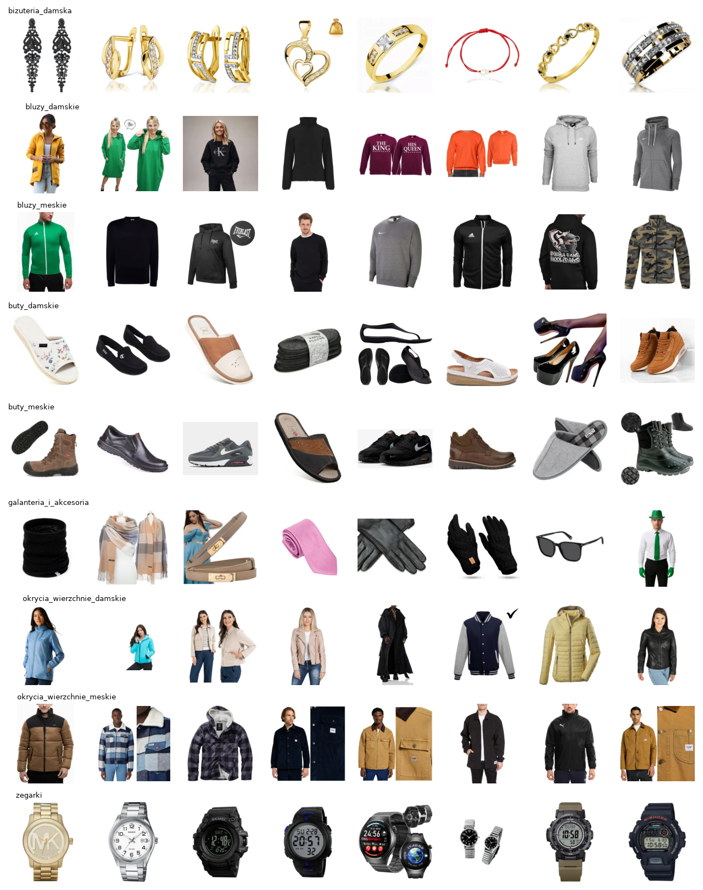
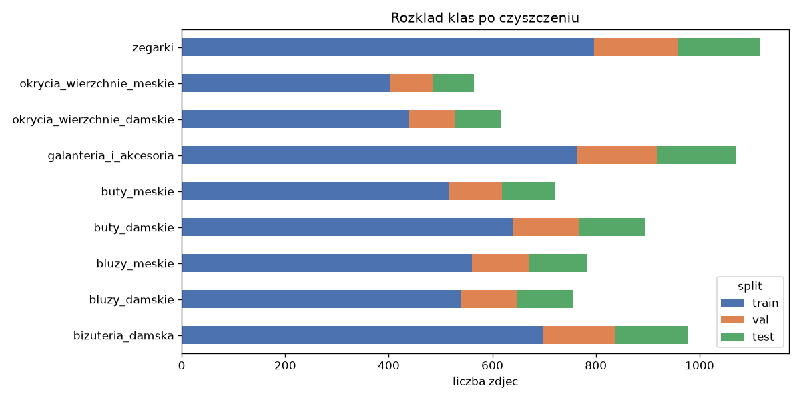
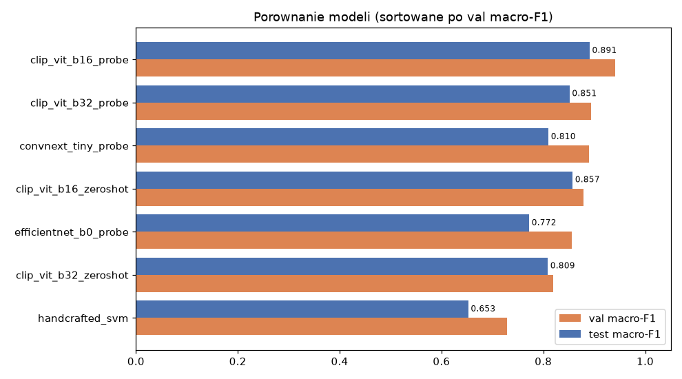
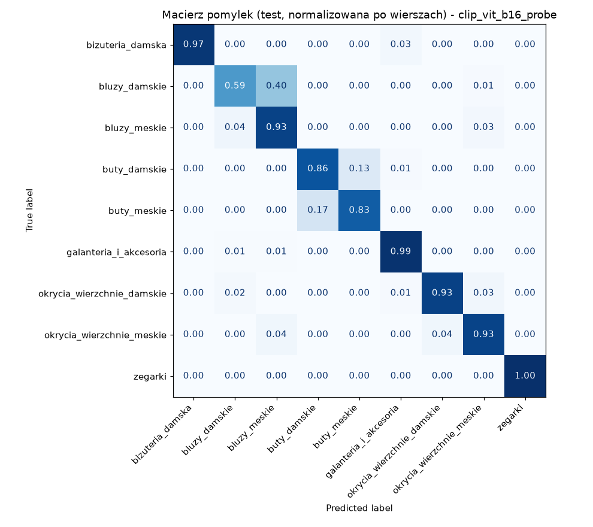
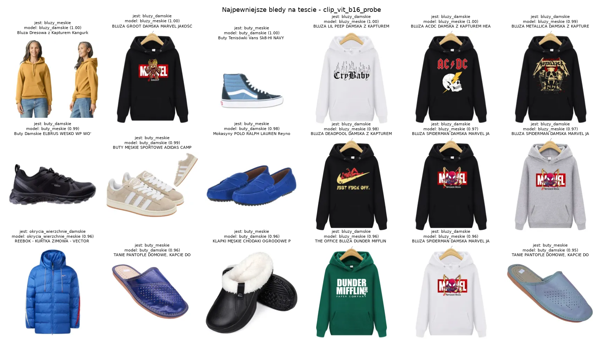

# Erli Machine Vision — klasyfikacja zdjęć produktów modowych

[](https://kedro.org)


Projekt: zescrapować dział [Moda](https://erli.pl/moda,6731) z **erli.pl** i zbudować model,
który na podstawie **samego zdjęcia** przypisuje produkt do jednej z 9 kategorii:

`buty_meskie` · `buty_damskie` · `okrycia_wierzchnie_meskie` · `okrycia_wierzchnie_damskie` · `bluzy_meskie` ·
`bluzy_damskie` · `galanteria_i_akcesoria` · `bizuteria_damska` · `zegarki`

## TL;DR

| | |
|---|---|
| **Dane** | 10 754 zdjęcia zescrapowane z erli.pl → **7 500** po walidacji i deduplikacji |
| **Najlepszy model** | CLIP ViT-B/16 (zamrożony) + regresja logistyczna (*linear probe*) |
| **Wynik na teście** | **90.1% accuracy**, 0.891 macro-F1 (9 klas) |
| **Typ produktu (bez płci)** | **98.4% accuracy** — prawie cały błąd to płeć przy produktach wizualnie unisex |
| **Inferencja** | jeden plik **ONNX** uruchamiany przez **`cv2.dnn`** — bez PyTorcha, ~120 ms/zdjęcie na CPU |
| **Zgodność OpenCV ↔ pipeline** | 100% identycznych predykcji, max różnica pewności 6·10⁻⁶ |

```text
$ python scripts/predict.py data/01_raw/images/zegarki/136179218.webp
   99.9%  zegarki
    0.0%  bizuteria_damska
    0.0%  bluzy_meskie
```

---

## Spis treści

1. [Podejście](#podejście)
2. [Dane](#dane)
3. [Modele i wyniki](#modele-i-wyniki)
4. [Analiza błędów](#analiza-błędów)
5. [Wdrożenie: OpenCV `cv2.dnn`](#wdrożenie-opencv-cv2dnn)
6. [Jak uruchomić](#jak-uruchomić)
7. [Struktura projektu](#struktura-projektu)

---

## Podejście

Zamiast od razu trenować jedną sieć, porównałem
**7 podejść** — od klasycznego computer vision w OpenCV po nowoczesne modele *vision-language* —
na tych samych, uczciwie podzielonych danych.

```mermaid
flowchart LR
    A[erli.pl<br/>listingi kategorii] -->|scrape_erli.py| B[01_raw<br/>zdjęcia + products.csv]
    B --> C[data_processing<br/>walidacja · dedup phash · split po grupach]
    C --> D[feature_extraction<br/>HOG+HSV · CLIP · ConvNeXt · EfficientNet]
    D --> E[training<br/>SVM · linear probe · zero-shot]
    E --> F[evaluation<br/>porównanie · raporty · analiza błędów]
    F --> G[deployment<br/>eksport ONNX · weryfikacja cv2.dnn]
    G --> H[scripts/predict.py<br/>tylko OpenCV + numpy]
```



---

## Dane

### Scraping

`scripts/scrape_erli.py` (konfiguracja: `scripts/scraper_config.yml`) pobiera miniatury produktów
z listingów kategorii erli.pl:

- **mapowanie klasa → kategorie erli** — np. `galanteria_i_akcesoria` składa się z 8 podkategorii
  (paski, portfele, okulary, czapki, szaliki, rękawiczki, plecaki, krawaty), a limit 1200 zdjęć
  dzielony jest między nie równo, żeby jedna podkategoria nie zdominowała klasy,
- **grzeczny dla serwera** — 3 s odstępu między stronami listingu, własny User-Agent, retry z backoffem,
- **ochrona anty-botowa nie jest obchodzona** — przy 403/captcha scraper czeka (wykładniczy backoff
  15 → 60 min) i po odblokowaniu zwalnia tempo,
- **odporny na przerwanie** — dane dopisywane są do `products.csv` po każdej stronie, a ponowne
  uruchomienie wznawia każdą kategorię od miejsca, w którym skończyła.

### Czyszczenie (`pipelines/data_processing`)

Surowe dane z marketplace'u są brudne: ten sam produkt w wielu wariantach rozmiarowych, te same
zdjęcia wystawione w różnych kategoriach, oferty „damskie” w kategorii męskiej itp.

| krok | efekt |
|---|---|
| walidacja zdjęć | odrzucenie miniatur < 100 px, uszkodzonych plików i niemal jednolitych obrazków (placeholdery) |
| duplikaty w tej samej klasie (identyczny *perceptual hash*) | **−3 109** (głównie warianty rozmiarowe/kolorystyczne) |
| to samo zdjęcie w dwóch różnych klasach | **−91** — etykieta niejednoznaczna, wyrzucamy obie strony |
| tytuł przeczy płci klasy (np. „damska” w bluzach męskich) | **−79** |
| **wynik** | **7 500 zdjęć** w **5 796 grupach** |

**Podział train/val/test (70/15/15) jest rozłączny po grupach.** Grupa = zdjęcia o phash-distance ≤ 6
albo o tym samym znormalizowanym tytule (union-find). Dzięki temu warianty tego samego produktu nie
lądują jednocześnie w treningu i teście — bez tego wyniki byłyby sztucznie zawyżone.

| | |
|---|---|
|  |  |

---

## Modele i wyniki

| model | cechy | val acc | val macro-F1 | **test acc** | **test macro-F1** |
|---|---|---:|---:|---:|---:|
| **clip_vit_b16_probe** | CLIP ViT-B/16 (DataComp-XL) + log. regresja | **0.945** | **0.941** | **0.901** | **0.891** |
| clip_vit_b16_zeroshot | CLIP ViT-B/16, opisy klas tekstem — **zero treningu** | 0.889 | 0.879 | 0.869 | 0.857 |
| clip_vit_b32_probe | CLIP ViT-B/32 (OpenAI) + log. regresja | 0.905 | 0.894 | 0.867 | 0.851 |
| convnext_tiny_probe | ConvNeXt-T (ImageNet-22k) + log. regresja | 0.902 | 0.890 | 0.836 | 0.810 |
| clip_vit_b32_zeroshot | CLIP ViT-B/32, zero-shot | 0.834 | 0.820 | 0.822 | 0.809 |
| efficientnet_b0_probe | EfficientNet-B0 (ImageNet-1k) + log. regresja | 0.871 | 0.856 | 0.801 | 0.772 |
| handcrafted_svm | **klasyczne OpenCV**: HOG + histogram HSV → PCA → SVM RBF | 0.745 | 0.728 | 0.677 | 0.653 |



Wnioski:

- **Klasyczne OpenCV daje solidny baseline (68%)** — HOG dobrze łapie kształt (zegarek vs but vs
  kurtka), ale nie ma szans z rozróżnieniem płci czy subtelnych różnic w odzieży.
- **CLIP > CNN-y z ImageNetu.** Modele trenowane na parach obraz–tekst z internetu „widziały”
  miliony zdjęć produktowych z e-commerce, więc ich reprezentacje lepiej pasują do tej domeny niż
  cechy z ImageNetu.
- **CLIP zero-shot bez żadnego treningu bije wszystkie CNN-y.** To praktyczny argument: nową
  kategorię można dodać samym opisem tekstowym, zanim zbierzemy dla niej dane.
- Wybór modelu i hiperparametru `C` odbywa się na **walidacji** (macro-F1); test służy tylko do
  końcowego raportu.

### Wyniki per klasa (test, najlepszy model)

| klasa | precision | recall | F1 | n |
|---|---:|---:|---:|---:|
| zegarki | 1.00 | 1.00 | **1.00** | 160 |
| bizuteria_damska | 1.00 | 0.97 | 0.99 | 140 |
| galanteria_i_akcesoria | 0.96 | 0.99 | 0.97 | 153 |
| okrycia_wierzchnie_damskie | 0.96 | 0.93 | 0.95 | 88 |
| okrycia_wierzchnie_meskie | 0.91 | 0.93 | 0.92 | 80 |
| buty_damskie | 0.86 | 0.86 | 0.86 | 128 |
| buty_meskie | 0.83 | 0.83 | 0.83 | 103 |
| bluzy_meskie | 0.69 | 0.93 | 0.79 | 112 |
| bluzy_damskie | 0.89 | **0.59** | 0.71 | 108 |

<p align="center"></p>

---

## Analiza błędów

Model **praktycznie nie myli typów produktów** — błędy to niemal wyłącznie **damskie ↔ męskie**
w obrębie bluz i butów. Po scaleniu płci accuracy na teście rośnie z 90.1% do **98.4%**.



Większość błędów to bluzy z nadrukiem na identycznym szablonie na wieszaku — wersja damska i męska
to to samo zdjęcie, płeć jest tylko w tytule oferty. Do tego jeden katalog takich bluz (85 produktów)
trafił w całości do testu. Bez niego accuracy na teście wynosi **93.6%**, zgodnie z walidacją (94.5%).

---

## Wdrożenie: OpenCV `cv2.dnn`

Pipeline `deployment` skleja **backbone CLIP + L2-normalizację + wytrenowaną warstwę liniową +
softmax** w jeden graf i eksportuje go do `data/06_models/fashion_classifier.onnx`, a obok zapisuje
`model_card.json` (klasy, parametry preprocessingu, metryki).

Następnie **automatycznie weryfikuje** wyeksportowany model w `cv2.dnn` na całym zbiorze testowym:

| | |
|---|---|
| OpenCV | 5.0.0 |
| obrazów | 1 072 |
| accuracy w `cv2.dnn` | 0.9011 (= pipeline) |
| zgodność predykcji z pipeline'em | **100%** (próg w konfiguracji: ≥ 99%) |
| max różnica pewności | 6.0 · 10⁻⁶ |
| mediana latencji (CPU, 1 zdjęcie) | ~119 ms |

Inferencja w produkcji wymaga więc tylko `opencv` + `numpy`:

```python
from scripts.predict import  FashionClassifier, load_rgb

clf = FashionClassifier()                     # wczytuje ONNX + model_card.json
clf.predict(load_rgb("kurtka.webp"), top=3)
# [('okrycia_wierzchnie_damskie', 0.974), ('okrycia_wierzchnie_meskie', 0.024), ('bluzy_damskie', 0.001)]
```

---

## Jak uruchomić

### Instalacja

```bash
python -m venv .venv
.venv\Scripts\activate            # Linux/macOS: source .venv/bin/activate
pip install -r requirements.txt
```

> `opencv-contrib-python>=5.0` jest wymagane — w OpenCV 5 `HOGDescriptor` przeniesiono do contrib.

### 1. Predykcja gotowym modelem

Plik ONNX (~345 MB) nie mieści się w repozytorium — pobierz `fashion_classifier.onnx` i
`model_card.json` z zakładki **Releases** do `data/06_models/` albo wygeneruj je krokami 2–3.

```bash
python scripts/predict.py zdjecie.jpg inne.webp
python scripts/predict.py https://i.erli.pl/tt1wce.23aae9.l.webp --top 3
```

### 2. Pobranie danych

```bash
python scripts/scrape_erli.py                      # wszystkie klasy, 1200 zdjęć/klasę
python scripts/scrape_erli.py --per-class 100      # szybki test
python scripts/scrape_erli.py --classes zegarki bluzy_damskie
```

### 3. Pełny pipeline

```bash
kedro run                                   # wszystko: dane → cechy → trening → ewaluacja → ONNX
kedro run --pipeline data_processing        # pojedyncze etapy:
kedro run --pipeline feature_extraction     #   (najdłuższy, ~30 min na CPU dla 4 backbone'ów)
kedro run --pipeline training
kedro run --pipeline evaluation
kedro run --pipeline deployment
kedro viz                                   # interaktywny graf pipeline'u w przeglądarce
```

Raporty i wykresy lądują w `data/08_reporting/`, metryki każdego modelu w
`data/08_reporting/metrics/`.

### Testy

```bash
pytest
```

Testy jednostkowe sprawdzają m.in. deduplikację i grupowanie, rozłączność splitu po grupach,
walidację uszkodzonych zdjęć, klasyfikatory oraz zgodność preprocessingu.

---

## Struktura projektu

```text
├── scripts/
│   ├── scrape_erli.py          # scraper erli.pl
│   ├── scraper_config.yml      # mapowanie klas → kategorie erli, limity, tempo
│   └── predict.py              # inferencja: tylko OpenCV cv2.dnn + numpy
├── src/erli_machine_vision/
│   ├── vision.py               # wspólny preprocessing (trening = produkcja)
│   ├── backbones.py            # CLIP (open_clip) i CNN-y (timm) jako ekstraktory cech
│   ├── classifiers.py          # linear probe, zero-shot, SVM — wspólny interfejs
│   ├── model_zoo.py            # rejestr porównywanych modeli
│   ├── datasets.py             # własne datasety Kedro (np. ONNX)
│   └── pipelines/
│       ├── data_processing/    # walidacja, deduplikacja, split po grupach
│       ├── feature_extraction/ # HOG+HSV i embeddingi z backbone'ów (cache)
│       ├── training/           # dobór C na walidacji, trening klasyfikatorów
│       ├── evaluation/         # porównanie modeli, macierz pomyłek, błędy
│       └── deployment/         # eksport ONNX + weryfikacja w cv2.dnn
├── conf/base/                  # catalog.yml + parameters_*.yml
├── docs/img/                   # wykresy użyte w README
└── tests/
```
